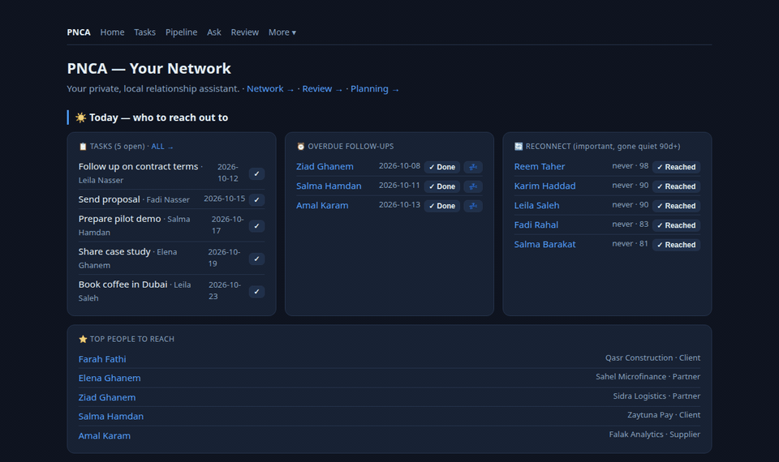
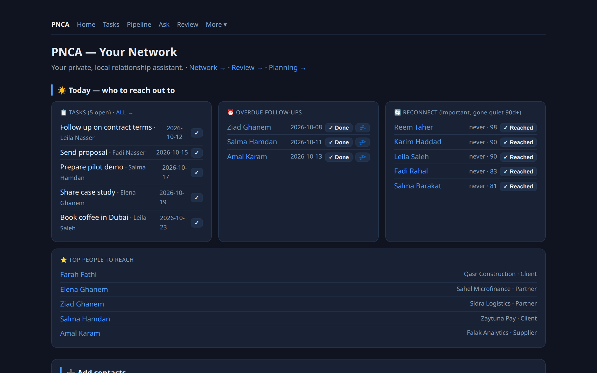
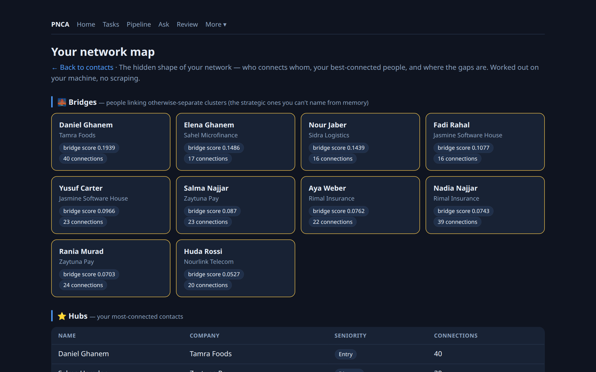
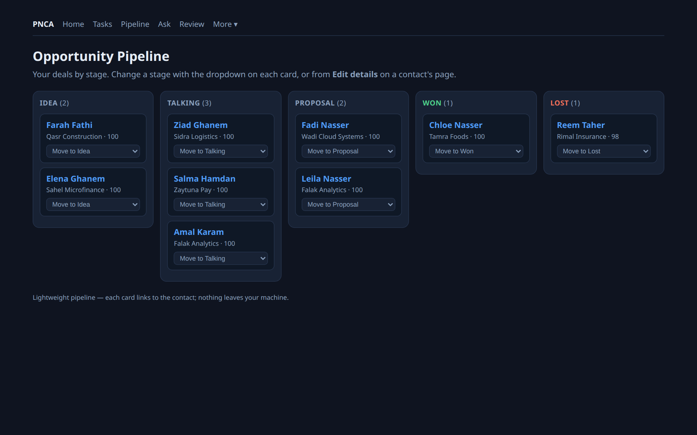
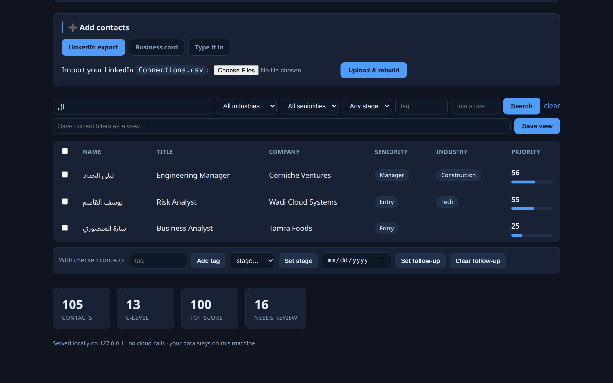
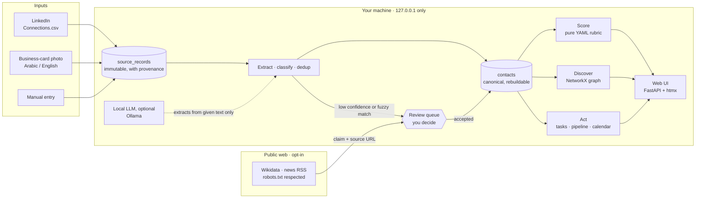
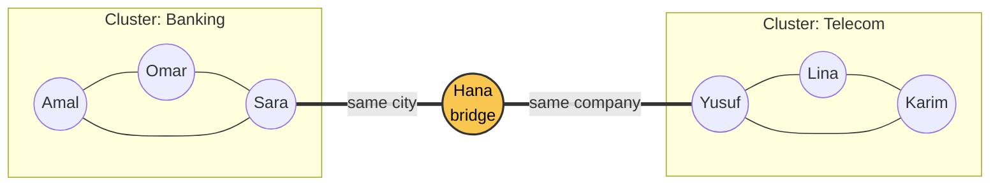
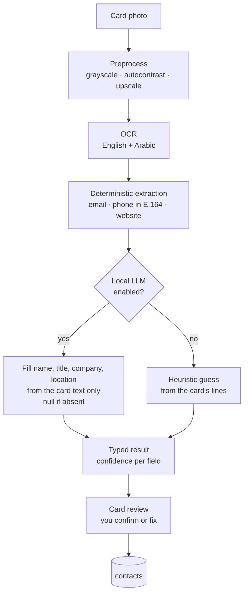
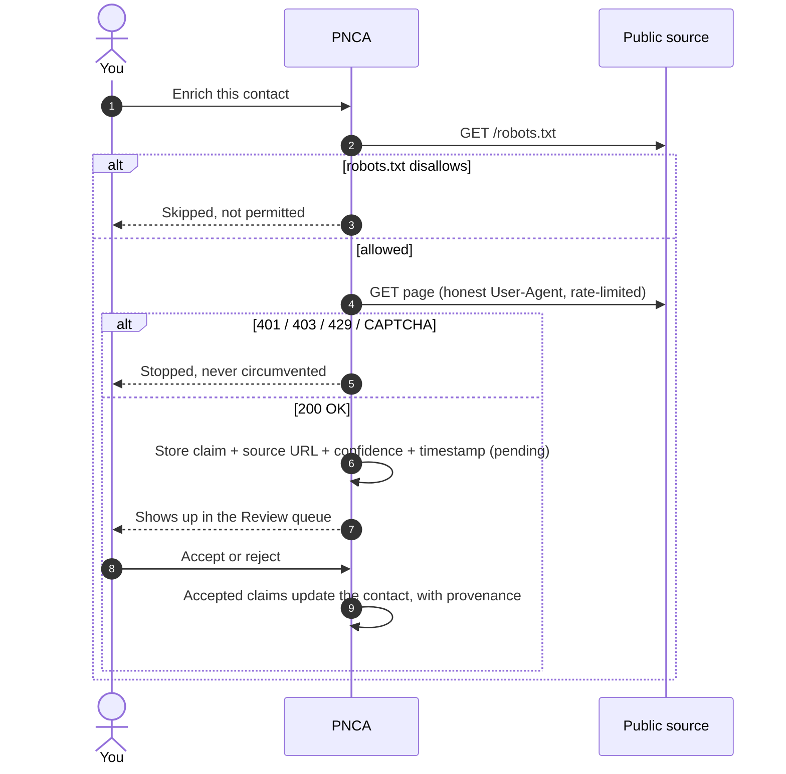

<div align="center">

# PNCA: Personal Network & Contact Analyzer

**A local-first, private CRM that tells you who matters in your network, who connects your circles, and who to reach out to next.**

[](https://github.com/faraj118/personal-network-analyzer/actions/workflows/ci.yml)
[](LICENSE)

[](https://github.com/faraj118/personal-network-analyzer/issues?q=is%3Aopen+label%3A%22good+first+issue%22)
[](https://github.com/faraj118/personal-network-analyzer/issues?q=is%3Aopen+label%3A%22help+wanted%22)
[](CONTRIBUTING.md)

[Quickstart](#quickstart) · [Screenshots](#screenshots) · [How it works](#how-it-works) · [Status](#project-status) · [**Help wanted: Arabic UI**](#call-for-helping-hands) · [Contributing](CONTRIBUTING.md)

</div>

---

Import your LinkedIn connections and business cards (in English **and Arabic**). PNCA cleans
and deduplicates them, ranks them with a transparent scoring rubric, maps your network as a
graph, and helps you follow up. It runs entirely on your machine: no cloud, no paid APIs, and
your contacts never leave your laptop.

Built in Tripoli, Libya, for people whose networks live in spreadsheets, card holders and
WhatsApp, not in a Salesforce instance.

<p align="center">
  
  <br><sub>Today page → searching names in Arabic → network map → pipeline. All people and companies are fictional (<a href="docs/demo/">demo data</a>).</sub>
</p>

## Why it exists

Professional networks are one of the most valuable assets people have, and one of the least
organised. The usual tools either:

- live in someone else's cloud, which is a non-starter for many people, organisations and regions;
- ignore Arabic, or anything that isn't a clean English email signature;
- or give you a list without telling you **who actually matters and why**.

PNCA takes the opposite approach: your data stays local, every number is explainable, and
nothing about a person is invented or saved without your approval.

## What it does

| | |
|---|---|
| **Import** | LinkedIn's official `Connections.csv` export, business-card photos (OCR, Arabic + English), or manual entry |
| **Clean** | Deduplicates contacts: exact email/phone auto-merge; fuzzy name/company matches go to a review queue |
| **Score** | Deterministic, explainable priority score from a YAML rubric (seniority, industry, geography, org prominence). No model assigns scores |
| **Discover** | Graph analytics with NetworkX: hubs, clusters, and **bridge contacts** who connect otherwise separate circles |
| **Enrich** | Optional, opt-in: free public sources (Wikidata, news RSS) add facts and "job change / funding" signals. Each comes with a source URL and confidence, and nothing is saved until you approve it |
| **Act** | Today home, follow-ups, tasks, pipeline (kanban), interaction timeline, `.ics` calendar export, CSV/JSON export |
| **Assist** | Optional local LLM (Ollama): draft a reconnect message, prep a meeting brief, ask your network in plain English |

## Screenshots

<table>
  <tr>
    <td width="50%"><br><sub><b>Today:</b> what to do and who to reach out to</sub></td>
    <td width="50%"><br><sub><b>Network map:</b> bridge contacts who link separate circles</sub></td>
  </tr>
  <tr>
    <td width="50%"><br><sub><b>Pipeline:</b> opportunities by stage</sub></td>
    <td width="50%"><br><sub><b>Arabic names:</b> stored and searched as written</sub></td>
  </tr>
</table>

Try it yourself with the synthetic [demo data](docs/demo/).

## How it works

Everything inside the middle box runs on your laptop and listens on `127.0.0.1` only. The
public web is touched only when you switch enrichment on, and even then nothing reaches your
contacts until you approve it.



### Find the people who connect your circles

Contacts are linked by real shared ties: the same company or the same city. Community
detection finds your clusters; betweenness centrality finds the **bridges**, the few people
who connect circles that otherwise never meet. They're often your best route to an
introduction.



<sub>Illustrative example with fictional names.</sub>

### Business cards in Arabic and English

Deterministic extraction always runs first and always wins. The local LLM, when enabled,
only fills the fields regex can't read (name, title, company, location), and only with text
that is actually printed on the card. Without the LLM, a simple line-based heuristic prefills
them instead. Either way, you confirm the result before it becomes a contact.



### Enrichment you can trust

Every fact found online is stored as a **claim with a source**, never as truth. Fetching is
polite by design, and a block means stop.



More diagrams (data model, deduplication rules, module layout) are in
[`docs/ARCHITECTURE.md`](docs/ARCHITECTURE.md).

## Design principles

- **Local-only.** The server binds to `127.0.0.1`. The SQLite database is gitignored and never leaves your machine.
- **Deterministic where it matters.** The scorer is a pure function of a YAML rubric; the LLM is never in the scoring path.
- **Nothing invented.** The LLM may only extract facts present in the text it's given. Every enriched fact carries its source and stays pending until you accept it.
- **Polite on the web.** Enrichment respects `robots.txt`, rate-limits itself, uses an honest User-Agent, and stops on any block. No scraping of login-walled sites.
- **Erasable.** Deleting a contact cascades to every fact and signal about them. No special-category data (health, religion, politics, etc.) is collected.
- **Degrades gracefully.** With the LLM off, everything except drafting and briefs still works.

## Quickstart

```bash
git clone https://github.com/faraj118/personal-network-analyzer.git
cd personal-network-analyzer
docker compose up -d --build
# then open http://127.0.0.1:8199 in your browser
```

Get your LinkedIn data: **LinkedIn → Settings → Data privacy → Get a copy of your data →
Connections**, then upload `Connections.csv` on the home page.

To enable the local LLM (optional):

```bash
docker compose exec ollama ollama pull qwen2.5:1.5b
# then set llm.enabled: true in config/app.yaml
```

<details>
<summary><b>Without Docker</b></summary>

```bash
python3 -m venv .venv && source .venv/bin/activate
pip install -e ".[dev]"                 # core
pip install -e ".[ocr,enrich]"          # optional: card OCR (needs tesseract) + enrichment
python -m app.main                      # http://127.0.0.1:8199
pytest -q
```

</details>

### Configuration

| File | Purpose |
|---|---|
| [`config/app.yaml`](config/app.yaml) | Server, database, LLM and enrichment settings |
| [`config/rubric.yaml`](config/rubric.yaml) | Scoring weights, your target industries and geographies |
| [`config/gazetteers/`](config/gazetteers/) | Title, seniority and industry keyword lists |

**Stack:** FastAPI · Jinja2 + htmx · SQLite (WAL) · pandas · NetworkX · rapidfuzz · Tesseract · Ollama.

## Project status

**Latest release: [v0.1.0](https://github.com/faraj118/personal-network-analyzer/releases/tag/v0.1.0).**
Pre-1.0, actively developed by a single maintainer, used daily by its author. 156 automated
tests run in CI on every pull request.

| Area | Status |
|---|---|
| CSV ingest, dedup, classification, deterministic scoring | ✅ Shipped |
| Network discovery: hubs, clusters, bridges, gaps | ✅ Shipped |
| Business-card OCR (Arabic + English) with LLM fallback | ✅ Shipped, needs a benchmark ([#1](https://github.com/faraj118/personal-network-analyzer/issues/1)) |
| Review-gated enrichment (Wikidata, news RSS) + contact profiles | ✅ Shipped |
| CRM: edit, tags, notes, pipeline, tasks, interactions, calendar export, saved views | ✅ Shipped |
| Local LLM assist: outreach drafts, meeting briefs, ask-your-network | ✅ Shipped |
| Arabic interface + right-to-left layout | 🔜 Top priority, help wanted ([#7](https://github.com/faraj118/personal-network-analyzer/issues/7)) |
| Visual network graph · encryption at rest · vCard | 🔜 Planned, help wanted |

Full backlog: [`docs/FEATURES.md`](docs/FEATURES.md) · phases: [`docs/ROADMAP.md`](docs/ROADMAP.md) · changes: [`CHANGELOG.md`](CHANGELOG.md).

## Where this can go

PNCA started as one person's tool, but the problem it solves is shared by a lot of people:

- **Professionals and job seekers** who want to know who in their network can open a door, without handing their contacts to a cloud CRM.
- **Founders, consultants and business developers** in markets where relationships matter more than inbound marketing.
- **Chambers of commerce, NGOs, incubators and community organisers** who collect hundreds of business cards at events and never turn them into relationships.
- **Arabic-speaking users**, whose cards, names and companies most tools handle badly or not at all.
- **Places with unreliable internet or strict data rules**, because PNCA works fully offline and keeps data on the device.

It's also a working reference for **responsible enrichment**: every fact sourced, every
claim reviewed by a human, robots.txt respected, no dark patterns. Other projects can borrow
that approach.

## Call for helping hands

### 🌍 Headline call: make PNCA speak Arabic ([#7](https://github.com/faraj118/personal-network-analyzer/issues/7))

PNCA already reads Arabic business cards and stores Arabic names as written, but its
interface is English only. An Arabic interface with a proper right-to-left layout is the single
biggest step towards making this a tool for the region. **You don't need Python for it**:
translating the interface text, reviewing wording, and fixing the RTL layout in HTML/CSS are
all valuable.

<div dir="rtl" align="right">

**نداء للمطوّرين والمتطوّعين العرب، وخاصة في ليبيا:** يقرأ PNCA بطاقات العمل العربية ويحفظ
الأسماء العربية كما هي، لكن واجهته ما زالت بالإنجليزية فقط. نبحث عمّن يساعد في ترجمة الواجهة
إلى العربية ودعم الكتابة من اليمين إلى اليسار. لا تحتاج إلى خبرة في بايثون: الترجمة ومراجعة
الصياغة وتنسيق الواجهة مساهمات مهمة. ابدأ من
[المهمة رقم 7](https://github.com/faraj118/personal-network-analyzer/issues/7) واترك
تعليقًا لنعرف أنك تعمل عليها.

</div>

### More ways to help

Pick something below, comment on the issue, and the maintainer will help you get started.
Several tasks need design, Arabic or research skills rather than code.

| Help needed | Skills | Issue |
|---|---|---|
| Synthetic Arabic/English business cards for an OCR benchmark | Design, Arabic | [#1](https://github.com/faraj118/personal-network-analyzer/issues/1) |
| Interactive offline network-graph view | JavaScript, data viz | [#2](https://github.com/faraj118/personal-network-analyzer/issues/2) |
| Encryption at rest + backup/restore | Python, SQLite, security | [#3](https://github.com/faraj118/personal-network-analyzer/issues/3) |
| vCard import/export | Python | [#4](https://github.com/faraj118/personal-network-analyzer/issues/4) · good first issue |
| "Why?" breakdown of the priority score | Python, HTML | [#5](https://github.com/faraj118/personal-network-analyzer/issues/5) · good first issue |
| Find a robots-permitted news feed (MENA sources welcome) | Research, Python | [#6](https://github.com/faraj118/personal-network-analyzer/issues/6) |
| Higher-accuracy OCR engine, benchmarked | Python, OCR | [#9](https://github.com/faraj118/personal-network-analyzer/issues/9) |
| Versioned releases and changelog automation | GitHub Actions, Docker | [#15](https://github.com/faraj118/personal-network-analyzer/issues/15) |

All open tasks: [issues](https://github.com/faraj118/personal-network-analyzer/issues).
Ideas and questions: [Discussions](https://github.com/faraj118/personal-network-analyzer/discussions).

## Contributing and community

- **Start here:** [`CONTRIBUTING.md`](CONTRIBUTING.md) covers setup, workflow, code style and the project's hard boundaries.
- **Code of conduct:** [`CODE_OF_CONDUCT.md`](CODE_OF_CONDUCT.md)
- **Security issues:** report privately, see [`SECURITY.md`](SECURITY.md)
- **Getting help:** [`SUPPORT.md`](SUPPORT.md)
- **How decisions are made:** [`GOVERNANCE.md`](GOVERNANCE.md)
- **Engineering spec:** [`SPEC.md`](SPEC.md) is the source of truth for architecture and boundaries.

## License

[Apache License 2.0](LICENSE) © 2026 Faraj Elburkie. Redistributions must keep the
[`NOTICE`](NOTICE) file.
