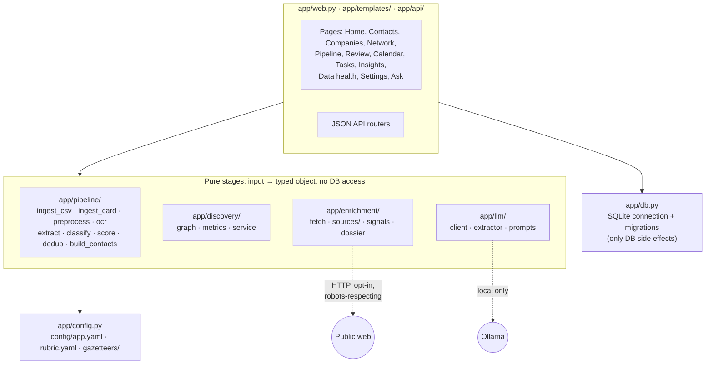
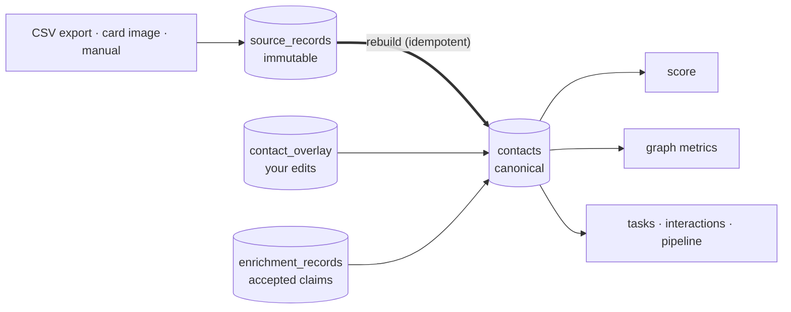
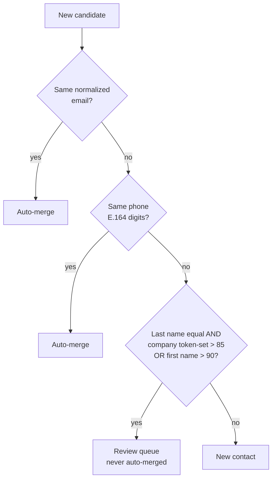
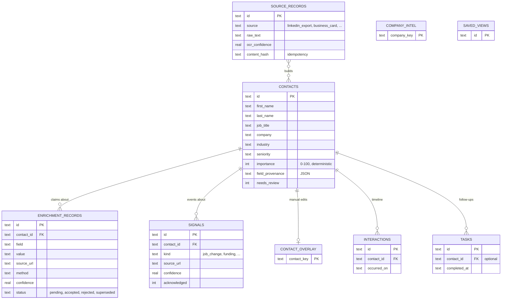

# PNCA Architecture (as built)

Mirrors `SPEC.md §2–§8`. This file tracks what actually exists in code; update it in the
same change that alters structure.

## Module layout

## Data flow

`contacts` can always be rebuilt from `source_records`, plus your manual edits
(`contact_overlay`) and accepted enrichment claims. Ingest is idempotent through
`content_hash`.

## Deduplication rules

Implemented in `app/pipeline/dedup.py` as a pure decision function. Tiers are checked in
order; the first match wins.

On a merge conflict, both values are kept in `field_provenance` and the contact is flagged
`needs_review`.

## Data model

Full column lists are in `db/migrations/*.sql`, applied idempotently on start-up. Deleting a
contact cascades to its enrichment records, signals and other personal data (erasure).

## Layering and boundaries

- **Config** (`app/config.py`): loads `config/app.yaml` once, validated by Pydantic. The
  only place host, port and asset paths are defined.
- **DB** (`app/db.py`): the only module with SQLite side effects. Schema in
  `db/migrations/*.sql`.
- **Pipeline** (`app/pipeline/`): pure `input -> typed object` stages, no DB access.
- **Discovery** (`app/discovery/`): pure graph build and metrics over contact dicts.
- **API** (`app/api/`): thin routers, one module per route group.
- **Models** (`app/models/`): Pydantic boundary schemas and closed enums.

## Runtime and deployment

- **Docker** (`Dockerfile`, `docker-compose.yml`) is the supported runtime:
  `python:3.14-slim`, running as non-root UID 1000 so files on the mounted `./data` volume
  are owned by your user.
- Localhost-only (§12) is enforced by the compose mapping `127.0.0.1:8199:8199`. The
  container process listens on `0.0.0.0` via the `PNCA_HOST` env override; port 8199 always
  comes from `config/app.yaml`.

## Key invariants

- `contacts` is always rebuildable (`SPEC.md §4, §11`).
- `content_hash` makes ingest idempotent; re-runs never duplicate.
- Closed enums (`config/rubric.yaml`): unknown values become `Unknown`, never guessed.
- Web fetches respect robots.txt and stop on 401/403/429/CAPTCHA; no evasion (`SPEC.md §15, §18`).
